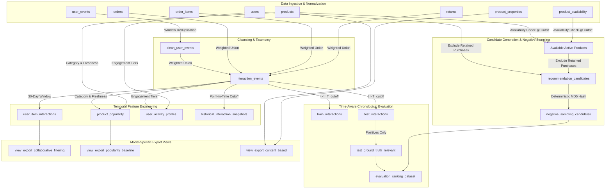

# Project 38: Implementation & Engineering Report
## E-Commerce Recommendation Engine Dataset Preparation Using Behavioral & Transactional SQL

### 1. Project Background & Technical Scope
The goal of Project 38 is to construct trustworthy, leak-free behavioral interaction matrices and time-aware evaluation datasets for machine learning recommendation engines. 

Using MySQL 8.0, this pipeline establishes a complete 3NF normalized schema, populates it with realistic e-commerce interactions, performs partitioned window-function event deduplication, computes implicit preference weights, handles temporal Slowly Changing Dimensions (SCD Type 2) for stock availability, generates candidate recommendation pools, samples contrastive negatives deterministically, and prepares ready-to-train datasets for Collaborative Filtering, Popularity Baselines, and Content-Based Filtering.

---

### 2. Implementation Architecture & Data Flow

---

### 3. Key Technical Challenges & Solutions
1. **Preserving Genuine Repetitive Behavior vs. Technical Retries**:
   - *Problem*: Ingestion duplicates must be purged without erasing customer browsing patterns where a user views an item repeatedly over days.
   - *Solution*: Window function `ROW_NUMBER() OVER (PARTITION BY source_event_id ORDER BY ingestion_timestamp, event_id)` ensures technical retries are pruned while genuine distinct user sessions remain intact.
2. **Eliminating Temporal Data Leakage**:
   - *Problem*: Traditional random splits expose future interactions to historical features, rendering offline evaluation artificially high.
   - *Solution*: A strict point-in-time boundary (`@train_cutoff`) enforces that zero training features access post-cutoff interactions, and availability is determined strictly via SCD Type 2 date intervals (`effective_from <= @train_cutoff AND (effective_to IS NULL OR effective_to > @train_cutoff)`).
3. **Contrastive Evaluation without Evaluation Contamination**:
   - *Problem*: Negative sampling must not sample items the user actually interacted with or purchased in the future test evaluation period.
   - *Solution*: Multi-table anti-joins exclude both training interactions and held-out test ground truth items before applying deterministic hash ranking.
